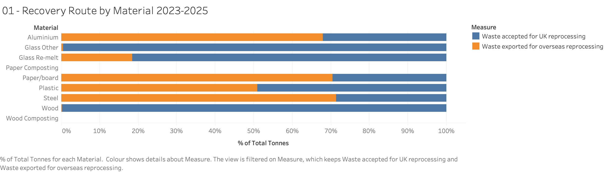
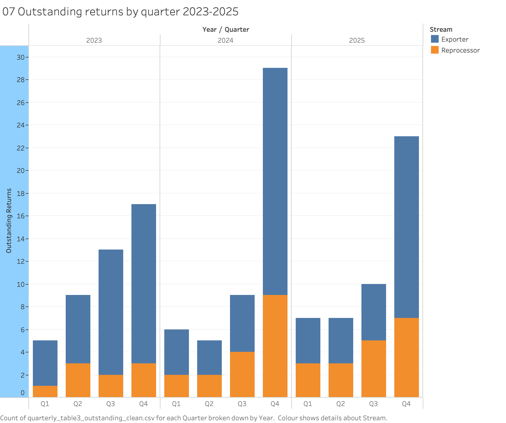

# UK Packaging Recovery Evidence, 2023 to 2026

**What the published data shows about packaging recycling in the UK, and what it cannot.**

Seven public datasets, cleaned and validated from scratch, turned into seven figures and a report.

Dr Celine Ozioma Ilo · Nova Cyclos · November 2026

---

## The short version

Companies that sell packaged goods in the UK have to prove that some packaging was recycled. They prove it by buying a certificate. One kind says a UK factory recycled this tonne. The other kind says this tonne was shipped abroad to be recycled. Both count the same.

This project takes every public dataset about those certificates, prepares them properly, and asks what the numbers actually show.

Read at face value, the data describes a system that works. In both years where the comparison can be made, evidenced recycling came in about three per cent above the legal target.

Four things sit underneath that headline.

### 1. Half of the UK's packaging recycling happens abroad, and price decides which half

Across 2023 to 2025, UK reprocessing accounted for 12,063,954 tonnes and export for 12,089,202. The export share is 50.1 per cent.

Split by material, the two routes pull completely apart. Wood is recycled in the UK 99.7 per cent of the time. Steel is exported 71.3 per cent of the time.



The rules do not ask for this. A UK certificate and an export certificate count identically, so where a tonne goes is a commercial decision rather than a legal one. The price of a certificate varies by a factor of 584 between the cheapest material and the dearest. Paper never rose above £8.94 a tonne in 2026. Plastic never fell below £234.09.

### 2. A credited tonne is not a tonne of packaging

Reprocessors take in mixed loads. An agreed protocol decides what share of a load counts as packaging. Those shares run from 100 per cent down to 0.6 per cent.

Steel's `1+2 Mixed` protocol turned 241,047 tonnes of incoming material into 1,326 tonnes of credited packaging in 2025. Most steel packaging evidence is a by-product of ordinary scrap processing rather than the output of a packaging recycling operation.

This is lawful and agreed with the regulator. The point is what the number means once it is added into a national recycling rate.

### 3. The books close later every year

Evidence for a compliance year is issued partly during the year and partly in the January after it ends. The January share rose from 9.6 per cent in 2023 to 14.5 per cent in 2025.

Anyone who builds an annual total by adding up the four quarterly files will be short by a tenth or more, and the shortfall is growing every year.

### 4. The published totals are a floor, not a measurement

Across twelve quarters, 140 returns from 63 accredited operators had not arrived when the figures were published.



Half of those fall in Q4, the quarter that decides compliance. Two thirds come from plastic exporters. No count of accredited operators is published anywhere, so this can only be stated as a number of companies and never as a compliance rate.

**None of this is an accusation.** Every mechanism described here is lawful, documented, and already sitting in public data. It only becomes visible once the data is prepared carefully enough to see it.

---

## What's in here

| Folder | Contents |
|---|---|
| `report/` | The full report, as PDF, Word and markdown. Ten pages, seven figures, a policy section and a statement of limits. |
| `figures/` | The seven figures as images, plus a note for each one recording what it shows, what it does not support, and what remains open. |
| `figures/build/` | The scripts that assemble the figure notes and the report. |
| `data/` | Seven dataset packages. Each holds the raw files unchanged, the parser, the cleaning rules, the cleaned output and the validation log. |
| `docs/` | The findings register: 38 findings with their supporting evidence. |

## The data packages

Each of the seven is self-contained and runs on its own with `./run_all.sh`.

| Package | Source | Cleaned output |
|---|---|---|
| `register-of-producers-2026` | Environment Agency | 12,078 rows, 61 validation rules |
| `recovery-evidence-quarterly-2023-2025` | Defra quarterly summaries | 4 tables, 2,825 rows, 255 checks |
| `recovery-evidence-monthly-2026` | NPWD monthly aggregates | 5 tables, 1,850 rows, 231 checks |
| `export-flows-2023-2025` | NPWD cumulative snapshots | 2 tables, 525 rows, 276 checks |
| `pepr-placed-on-market-2023-2025` | PackUK / Defra | 4 tables, 1,045 rows, 250 checks |
| `prn-revenue-2023-2025` | Environment Agency | 216 rows, 57 checks |
| `producer-obligations-2023-2024` | Defra | 4 tables, 484 rows, 42 checks |

Totals: 21 prepared files, 19,023 rows, 1,111 validation checks.

Row counts are true CSV records, not line counts. One row in the producer register contains a line break inside a quoted field, so counting lines overstates that file by one.

## How the data was prepared

Each package follows the same shape. Raw files are never edited. A parser reads them, an explicit rule file records every cleaning decision, and a validation log records every check and its result.

Cleaning decisions are sorted into three kinds and written down rather than applied quietly:

1. **Errors fixed.** A value that is wrong and can be corrected.
2. **Values standardised.** Variant spellings of the same thing, mapped to one form.
3. **Problems reported, not fixed.** Something wrong in the source that is left visible on purpose.

If the parser meets a value that no rule covers, the run stops rather than guessing. Nothing passes through unexamined.

**Two of the 1,111 checks fail, and the failures are left in.** Both had assumed that flows inside a single month must balance. They do not, because the system carries stock between periods. The checks were wrong and the data was fine. They are kept because a set of checks that has never failed has usually never been pointed at anything difficult.

## Reproducing it

```bash
git clone https://github.com/<your-username>/uk-packaging-evidence-analysis.git
cd uk-packaging-evidence-analysis/data/recovery-evidence-quarterly-2023-2025
pip install -r requirements.txt
./run_all.sh
```

Each package writes its cleaned output to `clean/` and its validation results to `logs/`. Re-running is safe and produces identical output.

The figures were built in Tableau Desktop from the cleaned CSVs. Each figure's note names the exact file, filter and calculation behind it.

## Sources

All seven datasets are published by Defra, the Environment Agency, the National Packaging Waste Database and PackUK, and were downloaded from their original locations.

Regulatory dates were checked against the Producer Responsibility Obligations (Packaging and Packaging Waste) Regulations 2024 on legislation.gov.uk, regulation 1(2) and (3), and against PackUK's annual report for 1 April 2025 to 31 March 2026.

## Licence and citation

Two licences, because this repository holds two kinds of work.

The report, figures, notes and cleaning rules are released under
**Creative Commons Attribution 4.0 (CC BY 4.0)**. You may use them, including
commercially, provided you give credit.

The scripts are released under the **MIT Licence**.

The raw files under `data/*/raw/` are published by UK public bodies and remain
subject to their original terms, which for most UK government data is the
Open Government Licence v3.0.

See `LICENSE` for the full statement.

**To cite this work:**

> Ilo, C. (2026) *UK Packaging Recovery Evidence, 2023 to 2026: What the
> published data shows, and what it cannot.* Nova Cyclos.

A `CITATION.cff` file is included, so GitHub will generate a formatted
citation from the "Cite this repository" button on the repository page.
